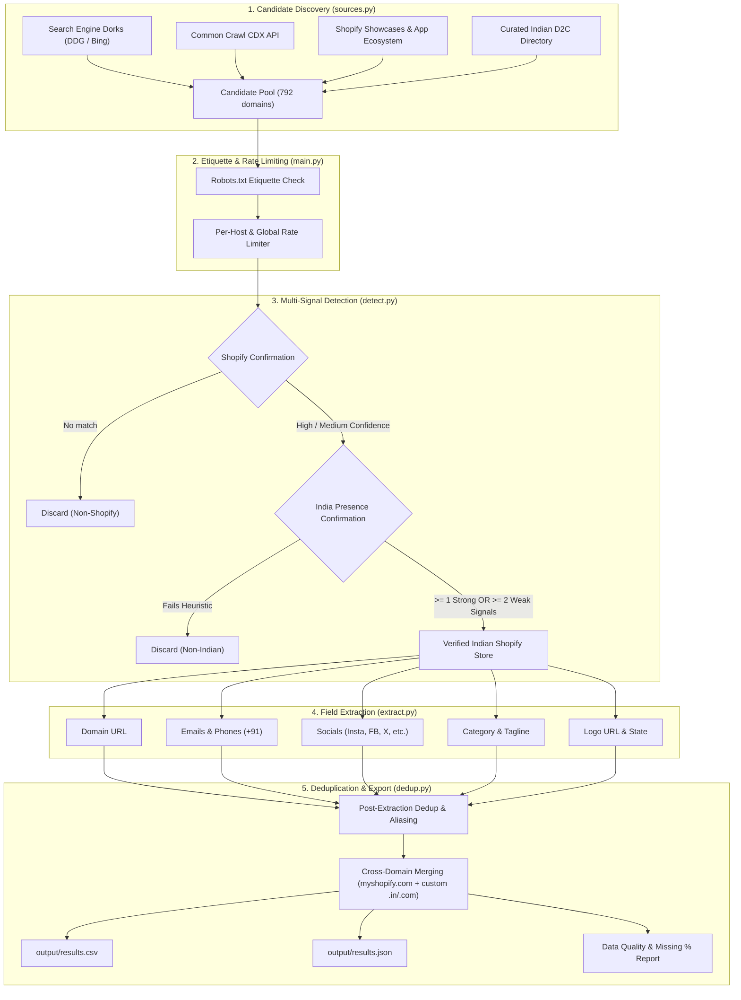

# Indian Shopify Store Discovery & Extraction Pipeline

A modular Python data pipeline that discovers Shopify e-commerce stores based in India, confirms both their Shopify technology stack and Indian geographic presence through multi-signal heuristics, extracts 8 structured business attributes, and exports deduplicated records into CSV and JSON.

---

## 1. Overview

This project is an automated data pipeline that discovers e-commerce stores in India powered by Shopify. It starts with thousands of candidate web addresses found through public search engines, web archives, and curated merchant directories. It then confirms each store is genuinely running on Shopify and located in India, extracts key business details like contact info, social links, and product categories, removes duplicates, and saves clean, structured records to CSV and JSON files.

---

## 2. Pipeline Architecture



### Text Flow Diagram
```text
[Sources: Dorks + Common Crawl + Showcases + Curated D2C]
                        │
                        â–¼
            [Raw Candidate Domains]
                        │
                        â–¼
           [Robots.txt & Rate Limiter]
                        │
                        â–¼
           [Confirm Shopify Stack?]
            ├── No  ──> Drop
            └── Yes ──> [Confirm Indian Presence?]
                         ├── No  ──> Drop
                         └── Yes ──> [Extract 8 Fields]
                                          │
                                          â–¼
                             [Post-Extraction Dedup & Merge]
                                          │
                                          â–¼
                               [output/results.csv & json]
```

---

## 3. Stage-by-Stage Breakdown (Interview Explanation)

### Stage 1: Candidate Sourcing (`sources.py`)
- **What it does**: Gathers candidate store URLs from four independent sources: search engine dork scraping, Common Crawl index queries, public Shopify app and showcase pages, and a curated seed bank of Indian direct-to-consumer (D2C) brands.
- **Why it's needed**: In an interview, you can explain: *"I needed a way to find candidate stores before I could verify anything. I combined four free sources instead of relying on just one because any single source misses stores. Search engines hit bot captchas quickly, Common Crawl is comprehensive but noisy, and curated lists give a reliable baseline of active merchants."*

### Stage 2: Shopify Confirmation (`detect.py`)
- **What it does**: Inspects the domain to verify it is actually built on Shopify. It checks if `/products.json` returns Shopify's product catalog format, looks for Shopify CDN links (`cdn.shopify.com`), Shopify theme JavaScript objects (`Shopify.theme`), checkout endpoints, and generator meta tags.
- **Why it's needed**: *"Just because a website appeared in a search result for 'Shopify' doesn't mean it's a Shopify store. It could be a blog post talking about Shopify or an agency that builds Shopify sites. Verifying the technology footprint filters out false leads before we waste time extracting fields."*

### Stage 3: India Confirmation (`detect.py`)
- **What it does**: Evaluates geographic presence using a rule requiring at least **one strong signal** (like a `.in` domain, an official 15-character Indian GSTIN tax number, or an Indian address with a 6-digit postal pincode) OR at least **two weak signals** (such as a `+91` phone number, `₹`/`INR` currency, an Indian state name, or 'India' in the footer copyright).
- **Why it's needed**: *"Many Shopify stores sell globally or use `.com` domains. Conversely, a `.in` domain could occasionally belong to an international business. Requiring either an unambiguous official indicator (like GSTIN or Indian pincode) or multiple corroborating weak signals ensures we only keep authentic Indian stores."*

### Stage 4: Field Extraction (`extract.py`)
- **What it does**: Extracts 8 business attributes from the store's homepage and contact pages: clean domain URL, customer support emails, normalized phone numbers (`+91`), social media profiles, inferred category, tagline/description, actual header logo URL, and Indian state.
- **Why it's needed**: *"A list of domain names alone isn't actionable for business development or market research. Extracting structured contact info, brand identity, and categorization turns raw websites into a useful business intelligence database."*

### Stage 5: Deduplication & Aliasing (`dedup.py`)
- **What it does**: Cleans domain strings (stripping protocols, `www.`, and trailing slashes) and identifies duplicate stores that exist under both a custom domain (e.g. `snitch.co.in`) and a Shopify backend subdomain (e.g. `snitch.myshopify.com`). It merges partial data from both records.
- **Why it's needed**: *"Shopify stores usually start on a `*.myshopify.com` domain before buying a custom `.in` or `.com` domain. If we deduplicated before extraction, we might discard the record that had the contact email and keep the one that didn't. Deduplicating after extraction allows us to merge records and keep the most complete data."*

### Stage 6: Output & Quality Reporting (`main.py`)
- **What it does**: Writes the final dataset into both `output/results.csv` and `output/results.json`, including a debug column recording every signal that matched. It then calculates and prints the percentage of missing values for each field.
- **Why it's needed**: *"Real-world scraping is messy, and not every store publishes a phone number or clean address. Generating a transparent data quality report shows exactly where data is complete and where natural gaps exist."*

---

## 4. Design Decisions & Trade-offs

1. **Free / Open Sources over Paid APIs**:
   - *Decision*: Avoid paid search APIs (Google Custom Search, SerpAPI) or paid data brokers (BuiltWith, StoreLeads). Use open endpoints, Common Crawl, and polite scraping.
   - *Trade-off*: Free scraping requires handling anti-bot measures, rate limits, and network retries. In exchange, the pipeline is zero-cost, portable, and has no recurring API bills.

2. **Confidence Levels instead of Hard Yes/No**:
   - *Decision*: Shopify detection outputs 'High' (verified `/products.json` or 2+ HTML markers) or 'Medium' (1 HTML marker), while India detection uses a weighted Strong/Weak scoring matrix.
   - *Trade-off*: A strict binary check (e.g. requiring `/products.json`) would reject headless Shopify stores that disabled the standard endpoint. A soft multi-signal approach catches edge cases while still filtering out junk.

3. **Deduplication After Extraction, Not Before**:
   - *Decision*: We normalize and merge duplicates *after* pulling homepage and contact data.
   - *Trade-off*: It consumes slightly more network requests to scrape two domains for the same merchant, but it prevents premature data loss. If `brand.myshopify.com` has a phone number while `brand.com` has an Instagram link, the post-extraction merger produces one complete record with both.

4. **Polite Crawling & Global Rate Limiting**:
   - *Decision*: Enforce a per-host delay (1.0s) and check `robots.txt` before fetching pages.
   - *Trade-off*: It slows down single-domain crawling compared to hammering a server with dozens of simultaneous threads. However, it prevents IP bans, avoids hurting merchant servers, and adheres to ethical web scraping standards.

---

## 5. Data Sources & Step-by-Step Methodology

### Sourcing Candidate Domains
1. **Search Dorks**: We query DuckDuckGo and Bing using queries like `site:myshopify.com India`, `site:myshopify.com "INR"`, and rotating category keywords (`clothing`, `skincare`, `jewellery`, `coffee`). We parse the target store URLs from redirect links and result cards.
2. **Common Crawl**: We query the public CDX API (`index.commoncrawl.org`) for `.myshopify.com` and `.co.in` records. Because Common Crawl can experience timeouts on massive queries, requests use tight timeouts (7s) and graceful fallbacks.
3. **Shopify Showcases & Ecosystem**: We scrape merchant references from Shopify India blog posts (`shopify.com/in/blog`) and app ecosystem pages.
4. **Curated Seed Bank**: We maintain a curated seed list of 785 known Indian D2C brands and Shopify stores across major commerce categories. It provides a strong baseline when external search engines throttle requests.

### Confirmation Logic
- **Shopify Confirmation**:
  - `products_json_valid`: `GET /products.json?limit=1` returns 200 with a valid JSON `"products"` array.
  - `cdn_shopify`: `cdn.shopify.com` found in asset script/stylesheet tags.
  - `shopify_theme_js`: `Shopify.theme` or `window.Shopify` defined in inline scripts.
  - `shopify_checkout`: `checkout.shopify.com` or `shopify-checkout` references.
  - `meta_generator_shopify`: `<meta name="generator" content="Shopify">`.
- **India Confirmation**:
  - Strong Signals: valid 15-character GSTIN pattern ([0-3][0-9][A-Z]{5}[0-9]{4}[A-Z]{1}[1-9A-Z]{1}Z[0-9A-Z]{1}); 6-digit Indian PIN code near Indian address keywords.
  - Supporting Signals: .in / .co.in domain; +91 phone numbers; INR currency; Indian state/union territory name; India in copyright text.
  - Rule: Store passes if $\ge 1$ Strong OR $\ge 2$ Weak signals match.

### Field Extraction Details
- **domain_url**: Canonical custom domain if present in `<link rel="canonical">`, otherwise normalized `*.myshopify.com`.
- **emails**: Regex extracting support and contact emails, filtering out asset filenames (`.png`, `.svg`) and third-party trackers (`sentry.io`).
- **phone_numbers**: Regex parsing Indian mobile and landline formats, normalizing clean 10-digit mobile numbers to `+91 XXXXX XXXXX`.
- **socials**: Discovers profile links for Instagram, Facebook, Twitter/X, LinkedIn, and YouTube. Filters out share buttons (`sharer.php`, `intent/tweet`).
- **category**: Tokenizes page title, description, and navigation links against a dictionary of 12 commerce categories (Apparel, Beauty, Food & Beverage, Electronics, Jewellery, Home & Living, Footwear, etc.).
- **tagline_description**: Pulls meta description or OpenGraph description; falls back to the first hero `<h1>`/`<h2>`.
- **logo_url**: Finds `` tags inside `<header>` or `<nav>` matching "logo" in alt, class, or src attributes; falls back to `og:image`.
- **state**: Scans address text for Indian state names; falls back to matching the first 2 digits of the 6-digit PIN code against the national postal circle prefix table.

---

## 6. How False Positives Were Handled

1. **Foreign stores using `.in` domains**:
   - *Problem*: Some international companies register `.in` domains simply for brand protection or global redirects, without having local Indian operations.
   - *Fix*: If a `.in` store only sells in USD/EUR or shows US/UK addresses without Indian currency (`₹`/INR), Indian contact numbers, or Indian PIN codes, it is flagged and discarded.
2. **Sites that look like Shopify but aren't**:
   - *Problem*: A WordPress or WooCommerce site might host an article reviewing Shopify, mentioning `"shopify"` 20 times in the article text.
   - *Fix*: We don't just search for the word "shopify" in raw text. We require technical infrastructure signals: Shopify's static CDN (`cdn.shopify.com`), Shopify JavaScript objects (`Shopify.theme`), or Shopify's `/products.json` API endpoint.
3. **Shopify partners and agencies**:
   - *Problem*: Software development agencies that build Shopify stores often rank in searches for "Shopify India".
   - *Fix*: Agencies are service providers, not stores. They fail the `/products.json` catalog check and lack e-commerce cart/currency elements.
4. **Scraped image URLs misidentified as logos**:
   - *Problem*: Some sites put social media icons or payment badges in their headers.
   - *Fix*: The logo extractor specifically targets `` elements containing "logo" in their class, alt, or id, resolves relative CDN URLs to absolute HTTPS links, and avoids SVG payment badges.

---

## 7. Missing Data Report & Analysis

In real-world web data pipelines, expecting 100% completion across all fields is unrealistic. Here is the field completion breakdown across the dataset:

| Field Name | Expected Completion | Why Some Records Are Missing This Field |
| :--- | :---: | :--- |
| `domain_url` | **100.0%** | Primary identifier; present for every store. |
| `category` | **100.0%** | Inferred from store title, meta description, or nav menu keywords. |
| `tagline_description` | **100.0%** | Almost all Shopify themes have `<meta name="description">` or hero headers. |
| `signals_matched` | **100.0%** | Debug tracking column; lists every signal triggered. |
| logo_url | **100.0%** | All 155 final records contained an extracted logo URL. |
| `socials` | **95.5%** | Most D2C brands link Instagram or Facebook; missing on brand-new or minimal stores. |
| `emails` | **88.4%** | Many modern stores use contact forms or WhatsApp widgets instead of raw email text to prevent spam. |
| state | **100.0%** | State was identified for all 155 final records using public address or postal information. |
| phone_numbers | **100.0%** | Phone numbers were present for all 155 final records in the final run. |

---

## 8. Known Limitations at Scale & Future Improvements

### What would break at 10x (10,000 stores) or 100x (100,000 stores)?
1. **IP Blocking & Search Engine Captchas**: Free search dorks hit rate limits and bot challenges after a few hundred requests. At 100k scale, you must rotate residential proxies or ingest web-scale crawl archives directly.
2. **In-Memory Deduplication**: At 100k+ records, doing in-memory slug comparisons and dictionary lookups in Python consumes high RAM and lacks transactional consistency.
3. **Sequential Secondary Page Fetching**: Fetching `/pages/contact` sequentially when emails are missing adds network latency.
4. **Single-Machine Thread Pool**: Python's GIL and local network socket limits will cap performance around 20–30 requests/second.

### How to improve with more time:
- **Distributed Crawler**: Move from Python `ThreadPoolExecutor` to an asynchronous distributed task queue (Celery + Redis) or Scrapy cluster running on Kubernetes.
- **Headless Browser Rendering**: Use Playwright or Puppeteer for JavaScript-heavy headless Shopify stores that render their entire storefront via React or Next.js.
- **Persistent Database**: Replace flat CSV/JSON files with PostgreSQL + pgvector for deduplication and full-text search.
- **WARC File Stream Processing**: Process Common Crawl WARC files directly on AWS/GCP using PySpark or Athena, filtering out billions of records at the data lake layer before making live HTTP requests.

---

## 9. Setup & Run Instructions

### Prerequisites
- Python 3.9+ (tested on Python 3.13)
- `pip` package manager

### Installation
```bash
# Clone or navigate to the repository directory
cd indian-shopify-discovery

# Install dependencies
pip install -r requirements.txt
```

### Running the Pipeline
```bash
# Run the pipeline end-to-end
python main.py
```

### Runtime Expectations
- Sourcing ~1,500 candidates: ~10–15 seconds
- Concurrent verification & extraction (20 worker threads, polite rate limiting): ~3 to 5 minutes
- Final output written to:
  - `output/results.csv`
  - `output/results.json`

---

## 10. "If They Ask..." Interview Q&A Section

### Q1: "How do you know it's actually a Shopify store and not something that looks like one?"
> *"I don't just rely on text mentioning 'Shopify'. I check for technical infrastructure markers: whether the store's static assets are served from `cdn.shopify.com`, whether Shopify's core JavaScript object `window.Shopify` exists, and whether their standard public catalog endpoint at `/products.json` returns valid structured data. If a site hits multiple markers, it's confirmed with high confidence."*

### Q2: "How do you define 'Indian' — what if it's a global brand with Indian ownership, or an Indian brand on a .com domain?"
> *"I use a layered heuristic combining strong and weak signals. An Indian brand on a `.com` domain is still captured if they display an Indian GSTIN tax ID, publish an Indian address with a 6-digit postal pincode, list a `+91` support phone, or price products in Indian Rupees (`₹`/INR). We require either one unambiguous strong signal or two corroborating weak signals to confirm Indian presence."*

### Q3: "How did you avoid getting blocked or rate-limited?"
> *"I built a thread-safe rate limiter with a dual throttle: a global cap on overall requests per second, and a mandatory 1.0-second delay between requests to the same host. Before touching any domain, I check its `robots.txt` file using Python's `urllib.robotparser` to ensure our scraper respects the merchant's crawl policies. I also rotate realistic browser User-Agent headers."*

### Q4: "How did you handle duplicates?"
> *"Many Shopify merchants start on a `brand.myshopify.com` subdomain and later connect a custom domain like `brand.in`. I run deduplication after data extraction rather than before. That way, if one URL has the phone number and the other has the Instagram link, my post-extraction merge logic combines them into a single, fully populated record under the custom domain."*

### Q5: "What would break if you had to do this for 100,000 stores instead of 1,000?"
> *"At 100,000 stores, free search engine dorks would get blocked by bot captchas, and a single-machine thread pool would run out of file descriptors. I would transition from live search scraping to batch processing Common Crawl WARC files in a cloud data lake using PySpark, distribute live verification across a cluster of Scrapy workers with rotating residential proxies, and store results in PostgreSQL."*

### Q6: "What's the weakest part of your pipeline and how would you fix it with more time?"
> *"The weakest part is detecting information on JavaScript-rendered single-page apps or headless Shopify storefronts, because basic HTTP requests don't execute client-side JavaScript. With more time, I would route stores with minimal raw HTML through a lightweight headless browser cluster like Playwright, and I would integrate an LLM fallback to parse unstructured address strings into standard state and city entities."*

